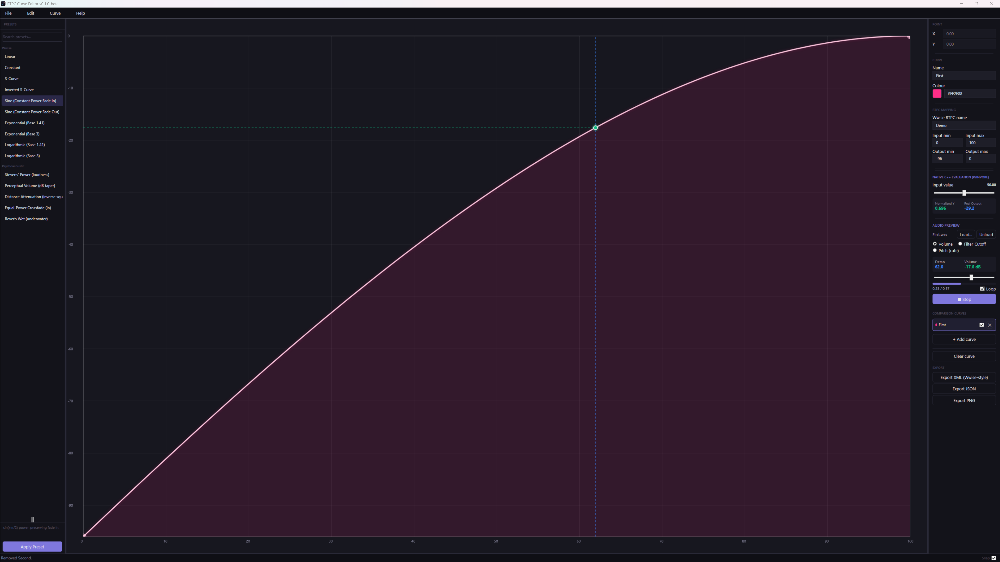

# RTPC Curve Editor

A standalone desktop tool for designing, editing, and previewing RTPC (Real-Time Parameter Control) curves for Wwise-style game audio workflows. Built with WPF, SkiaSharp, and C# on .NET 10.



---

## Why this exists

Wwise's built-in curve editor works, but it's tied to the project, limited to a fixed set of named interpolation shapes per segment, and has no easy way to compare curves side by side. Hearing a curve means setting the sound up inside the project first. This tool lives outside Wwise entirely: design your curves with free-form Bézier control, hear them applied to your own audio live, then use the shape as a reference when you rebuild it in your project.

---

## Features

- **Interactive Bézier canvas**: add, move, and delete control points; drag independent left/right tangent handles for free-form shaping
- **Wwise-style presets**: Linear, Constant, S-Curve, Inverted S-Curve, Sine (constant-power fade in and out), Exponential and Logarithmic (base 1.41 and 3). These are hand-tuned Bézier approximations of Wwise's named shapes, not exact copies. Applicable to the whole curve or a selected segment (points inside the selected segment are replaced by the preset's single segment)
- **Psychoacoustic presets**: Stevens' Power (loudness), Perceptual Volume (dB taper), Reverb Wet, Distance Attenuation (inverse square) and Equal-Power Crossfade. Also Bézier approximations of the named curves, tuned by ear and by eye, so they follow the general shape of the formula rather than reproducing it exactly
- **Comparison view**: overlay up to 4 curves on the same canvas with colour coding, and pick a curve's colour with a built-in colour picker
- **Live audio preview**: load a sound effect and hear your curve drive it in real time, in three modes:
  - **Volume**: curve output drives playback gain (dB)
  - **Filter Cutoff**: curve output drives a live low-pass filter (Hz)
  - **Pitch (rate-based)**: curve output drives playback rate; pitch and speed move together, like a sped-up record, not independent pitch-shifting
- **Native C++ evaluator**: a P/Invoke-backed Bézier evaluator that drives the live test-input readout. The canvas and exports use the managed implementation
- **Wwise-style XML export/import**: models Wwise's real curve concepts (shape names, RTPC Input/Output mapping) for round-tripping within this app and as a reference format (see [Wwise XML: what "compatible" actually means](#wwise-xml-what-compatible-actually-means) below)
- **JSON export**: flat sample array with mapped real-world values, for custom tooling
- **PNG export**: high-resolution curve render for documentation or presentations
- **Native project format**: save and load `.rtpce` files (JSON under the hood, fully diffable in Git)
- **Undo / redo**: full command stack, covers point edits, presets, comparison curves, and range changes
- **RTPC mapping**: set real-world input/output ranges; all exports map normalised 0–1 to your actual parameter ranges, and changing the range afterward preserves each point's real value and the curve's exact shape
- **Keyboard shortcuts**: `Ctrl+Z/Y`, `Ctrl+S`, `Ctrl+O`, `Ctrl+N`, `Delete` to remove selected point

---

## Tech stack

| Layer | Technology |
|---|---|
| UI framework | WPF (.NET 10, C#) |
| MVVM | CommunityToolkit.Mvvm 8.4.2 (`[ObservableProperty]`, `[RelayCommand]`) |
| Canvas rendering | SkiaSharp 3.119.2 |
| Native evaluator | C++ via P/Invoke |
| Audio preview engine | NAudio |
| Serialisation | System.Text.Json (inbox, .NET 10) |
| Export formats | Wwise-style XML, JSON, PNG |

---

## Architecture

```
RTPCCurveEditor/
├── Models/                    # CurvePoint, BezierCurve, CurveDocument, CurvePreset
├── ViewModels/                # MainViewModel (MVVM, all commands and state)
├── Commands/                  # UndoRedoStack, ICurveCommand, concrete command classes
├── Services/                  # WwiseXmlService, JsonExportService, PngExportService,
│                               ProjectFileService, AudioPreviewService,
│                               FilterSampleProvider, VariSpeedSampleProvider
├── Native/                    # NativeEvaluator.cs: P/Invoke bindings to the C++ evaluator
├── RTPCCurveEvaluatorNative/   # Native C++ project (the evaluator itself)
├── Presets/                   # PresetLibrary: curve shape presets
├── Views/                     # MainWindow, CurveCanvasControl, PresetLibraryPanel,
│                               InspectorPanel, ColorPickerButton
├── Converters/                # NullToBoolConverter, InverseBooleanToVisibilityConverter,
│                               ActiveCurveBorderConverter
└── Resources/                 # Styles.xaml (dark theme, palette, control templates)
```

The Bézier engine uses piecewise cubic interpolation and solves for the curve parameter at a given x (Newton iteration with a bisection fallback), so sampling stays accurate across arbitrary control point distributions. The sine fade presets closely follow sin and cos quarter waves. The other presets are hand-tuned Bézier approximations of their named shapes, and the psychoacoustic ones are inspired by the cited models (such as Stevens' power law) rather than exact evaluations of them.

---

## Getting started

### Prerequisites
- [Visual Studio 2026](https://visualstudio.microsoft.com/) with **both**:
  - the **.NET desktop development** workload
  - the **Desktop development with C++** workload (required for the native evaluator, the build will fail without it)
- [.NET 10 SDK](https://dotnet.microsoft.com/download)

### Build

Plain `dotnet build`/`dotnet restore` will **not** work for this solution, because the .NET CLI's bundled MSBuild can't build the native C++ project. Use one of these instead:

**Visual Studio:** open `RTPCCurveEditor.slnx` and press `F5`, or **Build → Build Solution**.

**Command line:** from a **Developer Command Prompt for VS 2026** (not a plain terminal):

```
git clone https://github.com/Code4Al1z/RTPC_Curve_Editor.git
cd RTPC_Curve_Editor
msbuild RTPCCurveEditor.slnx /t:Build /p:Configuration=Release /p:Platform=x64
```

---

## Usage

| Action | How |
|---|---|
| Add a control point | Double-click on the canvas |
| Remove a control point | Double-click an existing point |
| Move a point | Left-click drag |
| Adjust Bézier handles | Select a point, then drag its tangent handles |
| Select a curve segment | Left-click on the curve line |
| Apply a preset to selection | Select preset in sidebar → Apply Preset |
| Zoom canvas | Mouse wheel |
| Delete selected point | `Delete` key |

---

## Export formats

### Wwise XML: what "compatible" actually means

The exported XML models Wwise's real curve concepts accurately: the curve shape names (`Linear`, `SCurve`, `Exp1`/`Exp3`, `Log1`/`Log3`, `Constant`) match Wwise's actual RTPC interpolation types, and the Input/Output structure reflects how Wwise thinks about a Game Parameter driving a curve. **It does not open in Wwise itself.** Wwise's Authoring tool has no general "import an RTPC curve from a file" feature. Curve data there is set up manually in its own curve editor UI or via WAAPI. This format is for round-tripping curves within this app (lossless, with control points and handles preserved exactly) and as an accurate reference format, not for direct Wwise file interop.

### JSON
Exports a flat array of `{ x, y, xMapped, yMapped }` samples (64 by default) plus metadata. Suitable for custom tooling or engine-side lookup tables.

### PNG
1200×800 high-resolution render of the curve with grid, axis labels, and anchor points. Suitable for technical documentation and pitch decks.

---

## Known limitations

- **Wwise XML is not literally Wwise-file-compatible**: see the section above. It's an accurate reference format and a lossless round-trip format for this app, not a drop-in file for Wwise itself.
- **Pitch preview mode is rate-based**, not true independent pitch-shifting, because pitch and playback speed move together, the way a sped-up record does.
- This is an **unsigned executable** if you download a release build. Windows may show a SmartScreen warning ("Windows protected your PC") on first launch. Click **"More info" → "Run anyway"** to proceed.

---

## Roadmap

- [ ] Multi-curve select with `Ctrl+click`
- [ ] Curve symmetry and mirroring tools
- [ ] Preset save/load from user-defined library
- [ ] WAAPI-connected live preview: drive an actual running Wwise instance directly, beyond the reference XML format above

---

## Author

**AL!Z / Aliz Pasztor**, Psychoacoustic-Visual Systems Engineer
[alizpasztor.com](https://alizpasztor.com)